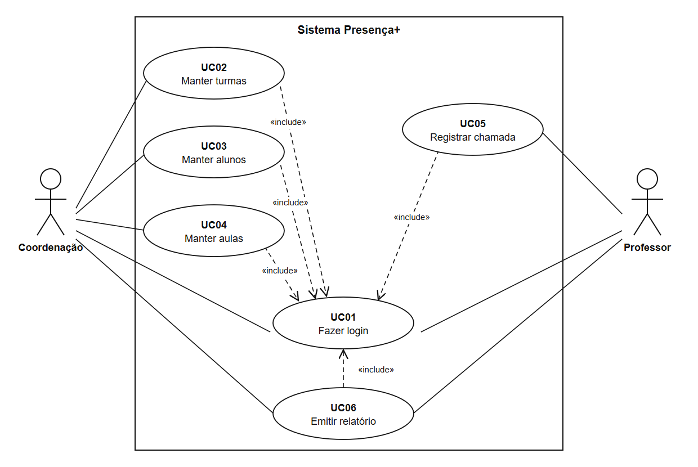

# Fase 1 — Análise de requisitos

Os requisitos descrevem o que o sistema deve fazer e as qualidades que deve apresentar (PRESSMAN; MAXIM, 2016). Foram separados em requisitos funcionais, requisitos não funcionais e regras de negócio.

## Requisitos funcionais

Tabela X — Requisitos funcionais

| ID | Requisito | Perfil |
|---|---|---|
| RF01 | Autenticar usuário com login e senha, e encerrar a sessão | Todos |
| RF02 | Manter turmas (criar, listar, editar, excluir) | Coordenação |
| RF03 | Manter alunos (criar, listar, filtrar por turma, editar, excluir) | Coordenação |
| RF04 | Manter aulas (criar, listar, editar, excluir) | Coordenação |
| RF05 | Registrar a chamada de uma aula, marcando os alunos que faltaram | Professor |
| RF06 | Emitir relatório de frequência por turma e período, com destaque para alunos abaixo de 75% | Todos |

Fonte: elaborado pelo autor (2026).

## Requisitos não funcionais

Tabela X — Requisitos não funcionais

| ID | Requisito |
|---|---|
| RNF01 | Segurança: toda página, exceto a de login, exige autenticação; senhas guardadas apenas como hash |
| RNF02 | Autorização: cada perfil acessa somente as funções indicadas para ele |
| RNF03 | Desempenho: páginas respondem em até 3 segundos com os dados de demonstração |
| RNF04 | Usabilidade: interface em português, datas dd/MM/aaaa, utilizável no navegador do celular (largura de 375 px) |
| RNF05 | Privacidade (LGPD): guardar só os dados necessários do aluno (nome, matrícula e turma), sem CPF, endereço ou telefone |

Fonte: elaborado pelo autor (2026).

O RNF05 segue o princípio da necessidade da Lei Geral de Proteção de Dados Pessoais, que limita o tratamento ao mínimo necessário para a realização de suas finalidades (BRASIL, 2018, art. 6º, III).

## Regras de negócio

Tabela X — Regras de negócio

| ID | Regra |
|---|---|
| RN01 | Frequência = (aulas com chamada − faltas) ÷ aulas com chamada × 100, contando apenas aulas da turma no período |
| RN02 | Situação: abaixo de 75% = "Abaixo de 75%"; de 75% até menos de 85% = "Atenção"; a partir de 85% = "Regular"; sem aula com chamada = "Sem aulas" |
| RN03 | Matrícula do aluno e nome da turma são únicos |
| RN04 | Não pode haver duas aulas na mesma turma, data e horário |
| RN05 | Chamada só pode ser registrada em aula com data igual ou anterior a hoje |
| RN06 | Na chamada, todos começam presentes. Salvar de novo substitui as faltas anteriores da aula |
| RN07 | O professor só vê e registra as próprias aulas |
| RN08 | Não se exclui turma com alunos ou aulas, aluno com faltas, nem aula com chamada registrada. O sistema avisa o motivo |

Fonte: elaborado pelo autor (2026).

O limite de 75% da RN02 vem da frequência mínima exigida pela LDB (BRASIL, 1996, art. 24, VI). A faixa "Atenção" é uma escolha do projeto, para sinalizar o aluno antes de ele atingir o limite.

## Diagrama de casos de uso

Os casos de uso especificam o comportamento esperado, isto é, o que deve acontecer, e não o método exato para isso (VISUAL PARADIGM, c2026b). O sistema tem dois atores: Coordenação e Professor. Os casos de uso UC02 a UC06 incluem o UC01, pois exigem usuário autenticado. A Figura X apresenta o diagrama.

Figura X — Diagrama de casos de uso

Fonte: elaborado pelo autor (2026).

## Descrição dos casos de uso

**UC01 — Fazer login**

- Ator: Coordenação e Professor.
- Objetivo: entrar no sistema com o próprio perfil.
- Passos principais: informar login e senha; o sistema valida os dados; a Coordenação é levada ao relatório e o Professor às suas aulas.

**UC02 — Manter turmas**

- Ator: Coordenação.
- Objetivo: criar, listar, editar e excluir turmas.
- Passos principais: abrir Turmas; escolher a ação; preencher nome, ano letivo e turno; salvar. O sistema recusa nome repetido (RN03) e a exclusão de turma com alunos ou aulas (RN08).

**UC03 — Manter alunos**

- Ator: Coordenação.
- Objetivo: criar, listar, filtrar por turma, editar e excluir alunos.
- Passos principais: abrir Alunos; escolher a ação; preencher matrícula, nome e turma; salvar. O sistema recusa matrícula repetida (RN03) e a exclusão de aluno com faltas (RN08).

**UC04 — Manter aulas**

- Ator: Coordenação.
- Objetivo: criar, listar, editar e excluir aulas.
- Passos principais: abrir Aulas; escolher a ação; informar turma, professor, disciplina, data e horário; salvar. O sistema recusa aula repetida na mesma turma, data e horário (RN04) e a exclusão de aula com chamada registrada (RN08).

**UC05 — Registrar chamada (caso de uso principal)**

- Ator: Professor.
- Objetivo: registrar os alunos que faltaram a uma aula.
- Passos principais: abrir Minhas aulas; escolher uma aula; marcar os alunos que faltaram, pois todos começam presentes; salvar. O sistema recusa aula futura (RN05), substitui as faltas anteriores ao salvar de novo (RN06) e impede o acesso à aula de outro professor (RN07).

**UC06 — Emitir relatório de frequência**

- Ator: Coordenação e Professor.
- Objetivo: consultar a frequência dos alunos de uma turma em um período.
- Passos principais: abrir Relatório; escolher turma, data inicial e data final; gerar. O sistema calcula a frequência (RN01), classifica a situação (RN02) e destaca os alunos abaixo de 75%. O relatório pode ser impresso.
