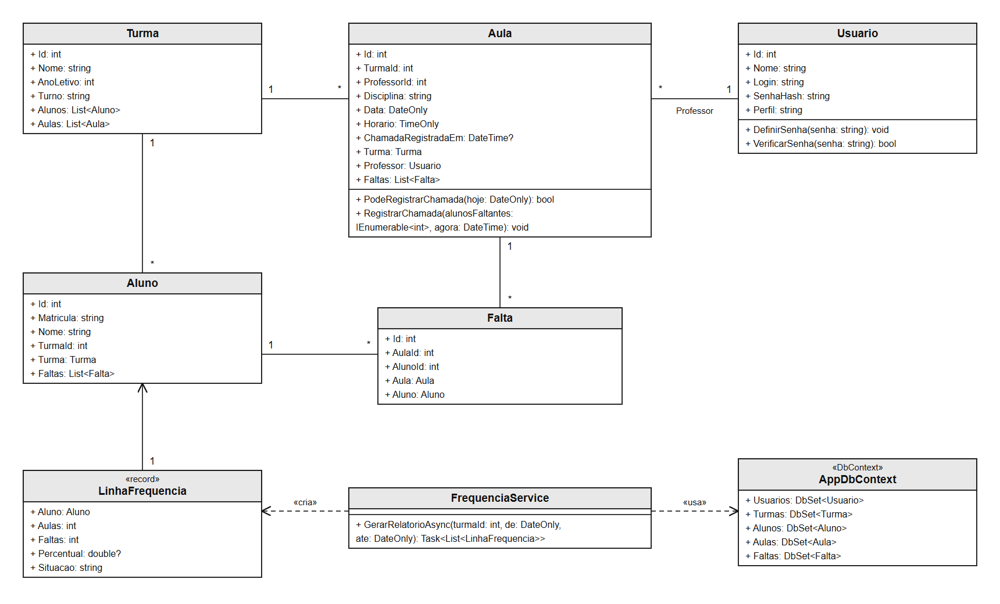
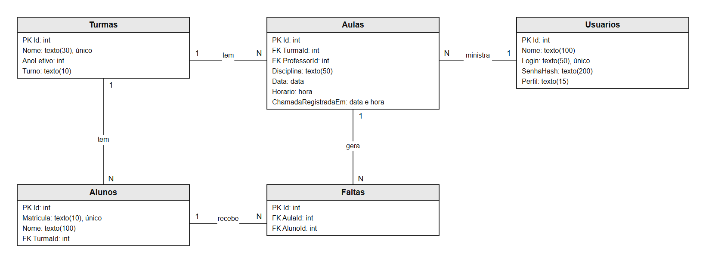
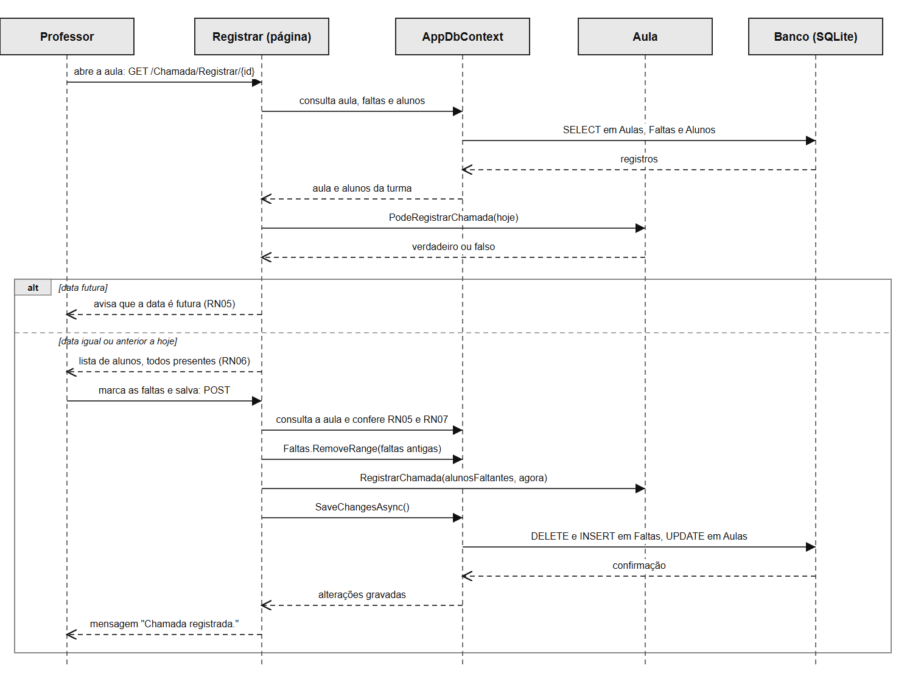

# Fase 2 — Modelagem do sistema

## Diagrama de classes

O diagrama de classes da Figura X mostra as classes do sistema. `Usuario`, `Turma`, `Aluno`, `Aula` e `Falta` representam os dados guardados. `Aula` concentra as regras da chamada, nos métodos `PodeRegistrarChamada` (RN05) e `RegistrarChamada` (RN06). `FrequenciaService` gera o relatório, e cada linha do resultado é um `LinhaFrequencia`, que calcula o percentual (RN01) e a situação (RN02). `AppDbContext` faz o acesso ao banco de dados.

Figura X — Diagrama de classes

Fonte: elaborado pelo autor (2026).

## Modelo entidade-relacionamento

O modelo entidade-relacionamento descreve os dados por meio de entidades, atributos e relacionamentos (ELMASRI; NAVATHE, 2011). A Figura X apresenta as cinco entidades do sistema. Uma turma tem vários alunos e várias aulas. Um professor, guardado em `Usuarios`, ministra várias aulas. Cada falta liga um aluno a uma aula. A ausência de registro em `Faltas` significa que o aluno esteve presente, o que evita guardar uma linha por aluno em cada aula.

Figura X — Modelo entidade-relacionamento

Fonte: elaborado pelo autor (2026).

## Dicionário de dados

As Tabelas X a X descrevem os campos de cada entidade.

Tabela X — Dicionário de dados da entidade Usuarios

| Campo | Tipo | Descrição | Obrigatório |
|---|---|---|---|
| Id | int | Identificador do usuário (PK) | Sim |
| Nome | texto(100) | Nome completo | Sim |
| Login | texto(50) | Login de acesso, único | Sim |
| SenhaHash | texto(200) | Hash da senha; a senha em si não é guardada | Sim |
| Perfil | texto(15) | `Coordenacao` ou `Professor` | Sim |

Fonte: elaborado pelo autor (2026).

Tabela X — Dicionário de dados da entidade Turmas

| Campo | Tipo | Descrição | Obrigatório |
|---|---|---|---|
| Id | int | Identificador da turma (PK) | Sim |
| Nome | texto(30) | Nome da turma, único | Sim |
| AnoLetivo | int | Ano letivo | Sim |
| Turno | texto(10) | `Matutino`, `Vespertino` ou `Noturno` | Sim |

Fonte: elaborado pelo autor (2026).

Tabela X — Dicionário de dados da entidade Alunos

| Campo | Tipo | Descrição | Obrigatório |
|---|---|---|---|
| Id | int | Identificador do aluno (PK) | Sim |
| Matricula | texto(10) | Matrícula, única | Sim |
| Nome | texto(100) | Nome completo | Sim |
| TurmaId | int | Turma do aluno (FK para Turmas) | Sim |

Fonte: elaborado pelo autor (2026).

Tabela X — Dicionário de dados da entidade Aulas

| Campo | Tipo | Descrição | Obrigatório |
|---|---|---|---|
| Id | int | Identificador da aula (PK) | Sim |
| TurmaId | int | Turma da aula (FK para Turmas) | Sim |
| ProfessorId | int | Professor da aula (FK para Usuarios) | Sim |
| Disciplina | texto(50) | Nome da disciplina | Sim |
| Data | data | Data da aula; única junto com TurmaId e Horario | Sim |
| Horario | hora | Horário da aula | Sim |
| ChamadaRegistradaEm | data e hora | Momento em que a chamada foi registrada; nulo indica chamada pendente | Não |

Fonte: elaborado pelo autor (2026).

Tabela X — Dicionário de dados da entidade Faltas

| Campo | Tipo | Descrição | Obrigatório |
|---|---|---|---|
| Id | int | Identificador da falta (PK) | Sim |
| AulaId | int | Aula em que houve a falta (FK para Aulas) | Sim |
| AlunoId | int | Aluno que faltou (FK para Alunos); único junto com AulaId | Sim |

Fonte: elaborado pelo autor (2026).

## Diagrama de sequência

O caso de uso principal é o UC05, Registrar chamada. A Figura X mostra a troca de mensagens entre o Professor, a página `Registrar`, o `AppDbContext`, a classe `Aula` e o banco de dados. Antes de exibir ou salvar a chamada, a página consulta `PodeRegistrarChamada`. Em aula futura, o sistema avisa e não permite o registro (RN05). Ao salvar, as faltas anteriores são removidas e as novas são gravadas (RN06).

Figura X — Diagrama de sequência do UC05, Registrar chamada

Fonte: elaborado pelo autor (2026).
