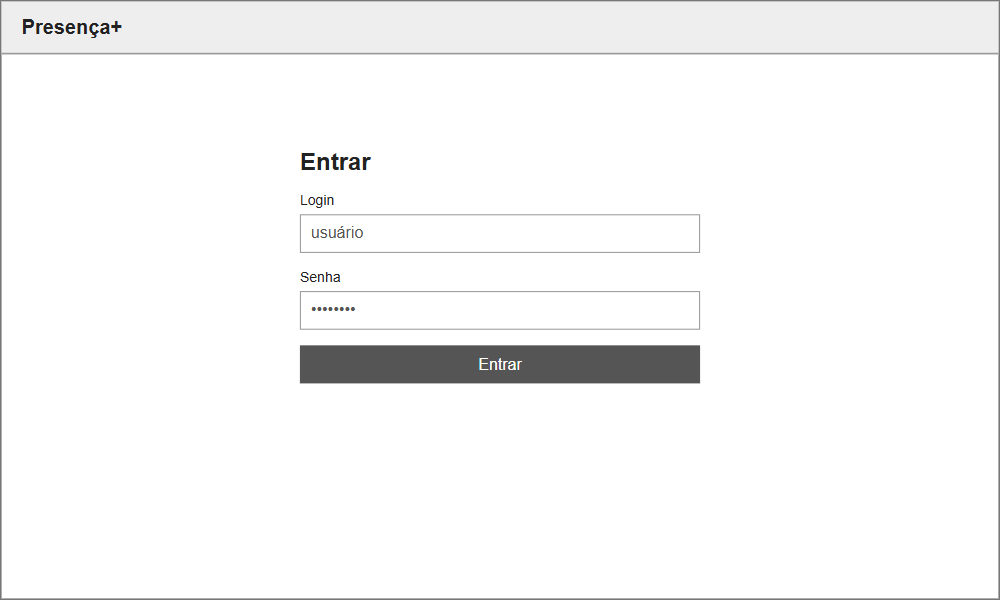
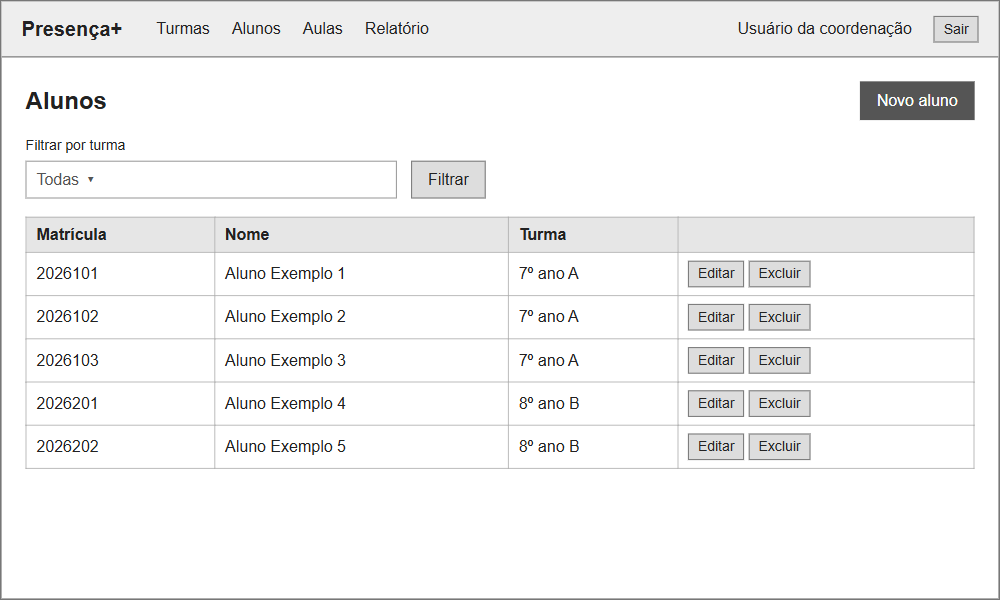
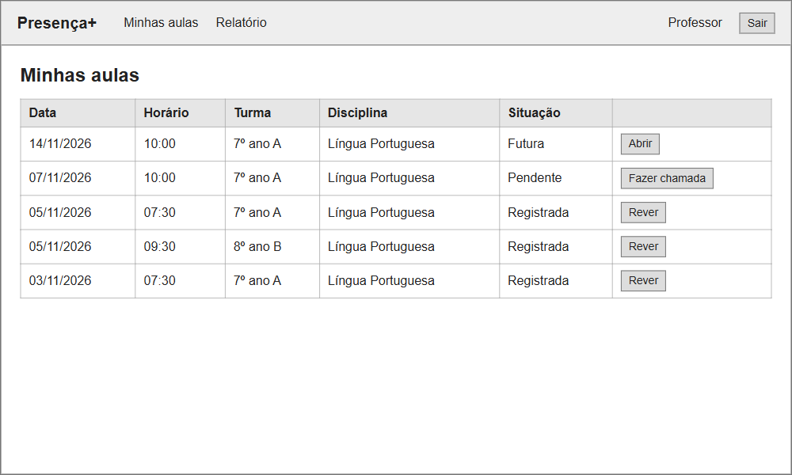
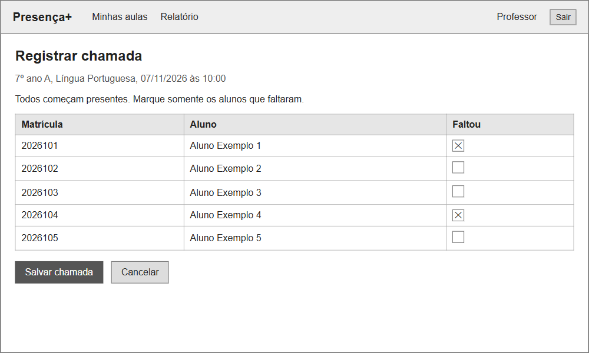
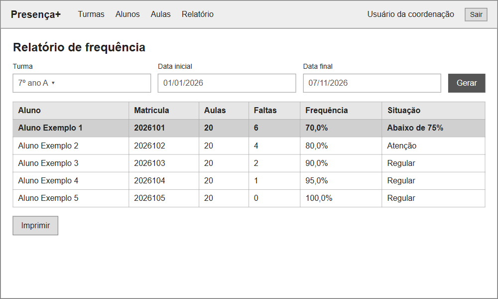

# Fase 3 — Prototipagem de telas

Os protótipos foram feitos como wireframes, em tons de cinza, para mostrar os campos e botões de cada tela. Os dados exibidos são fictícios.

## Login

Figura X — Protótipo da tela de login

Fonte: elaborado pelo autor (2026).

A tela de login dá acesso ao sistema (RF01). O usuário informa login e senha e é levado à página do seu perfil.

## Alunos

Figura X — Protótipo da tela de alunos

Fonte: elaborado pelo autor (2026).

A tela de alunos lista os alunos cadastrados (RF03). A Coordenação filtra por turma e usa os botões para cadastrar, editar ou excluir um aluno.

## Minhas aulas

Figura X — Protótipo da tela Minhas aulas

Fonte: elaborado pelo autor (2026).

A tela Minhas aulas mostra somente as aulas do professor conectado, com a situação de cada chamada: pendente, registrada ou futura (RN07). O professor escolhe uma aula para fazer ou rever a chamada.

## Registrar chamada

Figura X — Protótipo da tela de registrar chamada

Fonte: elaborado pelo autor (2026).

A tela de chamada lista os alunos da turma, todos começando presentes (RF05, RN06). O professor marca quem faltou e salva.

## Relatório de frequência

Figura X — Protótipo da tela de relatório de frequência

Fonte: elaborado pelo autor (2026).

A tela de relatório mostra a frequência dos alunos de uma turma no período escolhido (RF06). O usuário escolhe turma e datas, gera o relatório e pode imprimi-lo; os alunos abaixo de 75% aparecem em destaque.
