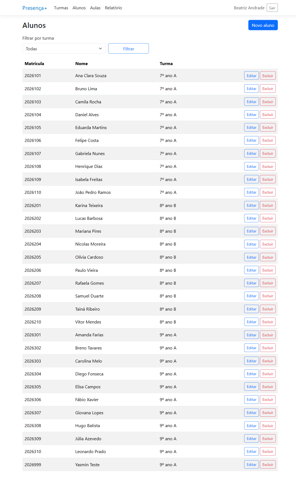
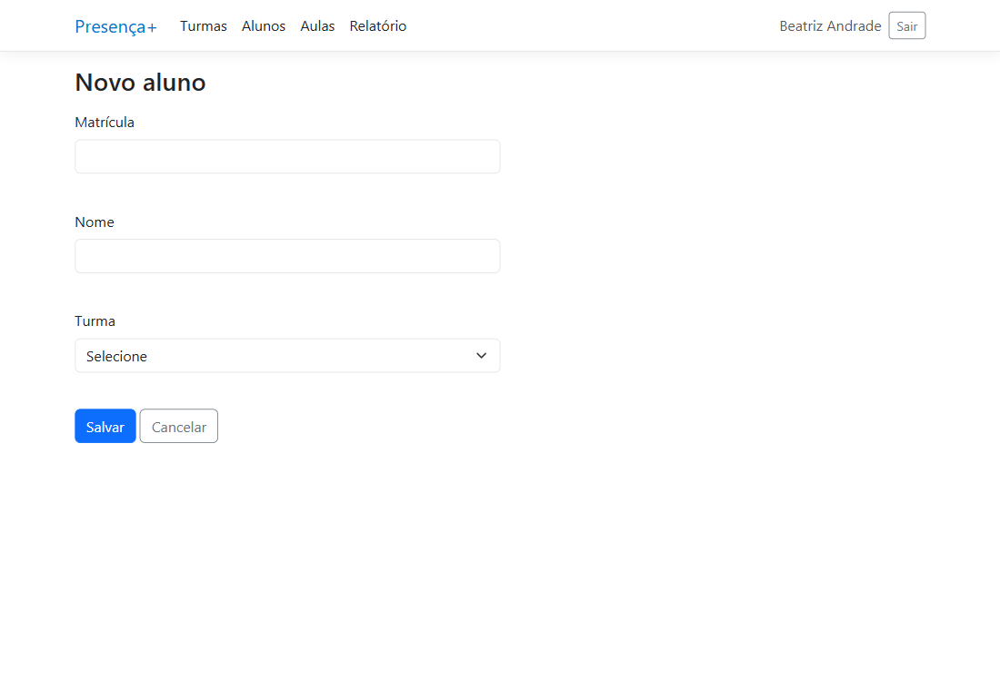
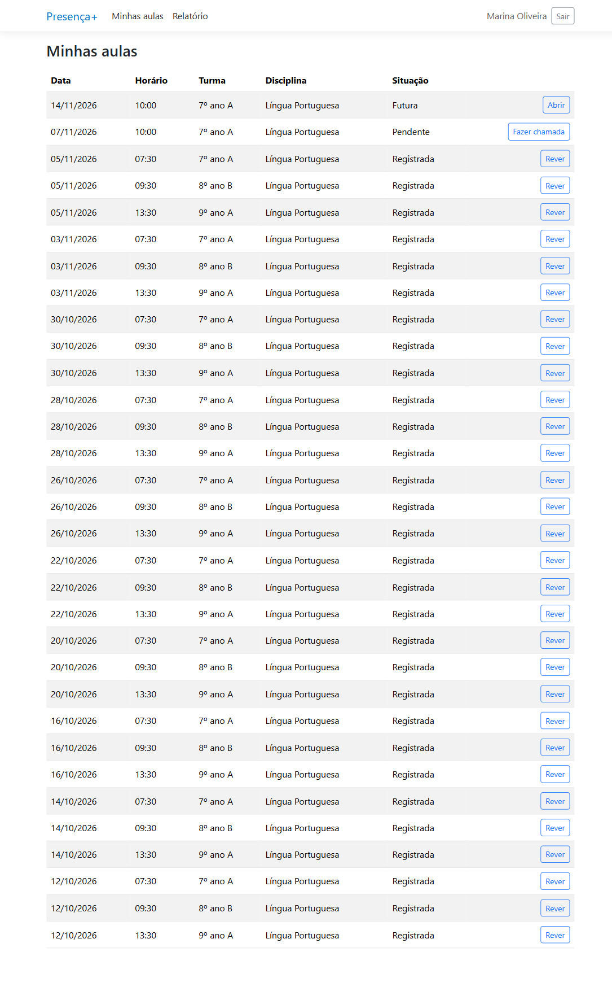
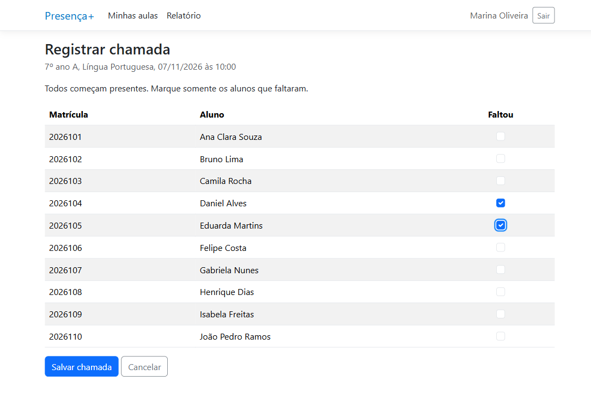
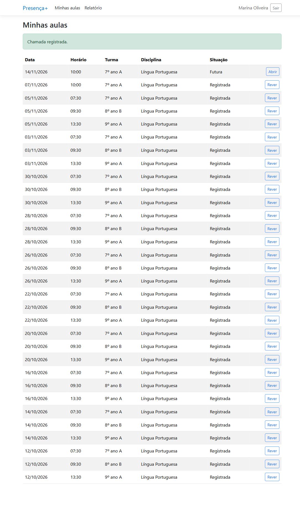
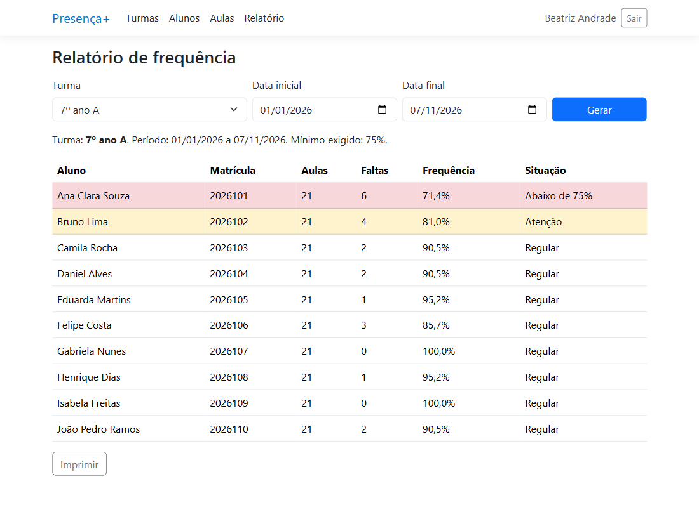
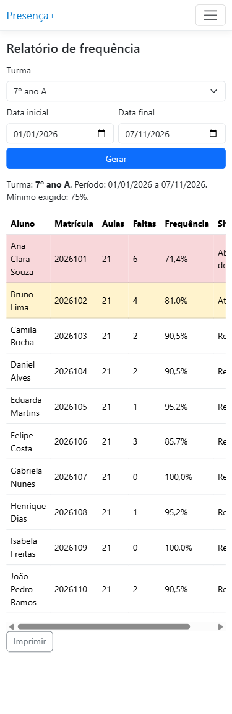

# Fase 4 — Desenvolvimento

## Ambiente

O sistema foi desenvolvido em C# com .NET 10 (SDK 10.0.400). O .NET é uma plataforma gratuita, multiplataforma e de código aberto (MICROSOFT, 2026a). A parte web usa o ASP.NET Core, framework para aplicações web modernas (MICROSOFT, 2026c), com Razor Pages, modelo em que cada página reúne a tela e o código que a atende (MICROSOFT, 2026d). A interface usa o Bootstrap, kit de ferramentas de front-end incluído no template do projeto (BOOTSTRAP, [202-]). O login usa autenticação por cookie, sem o ASP.NET Core Identity (MICROSOFT, 2026e). O código é versionado com Git (CHACON; STRAUB, 2014).

Repositório: https://github.com/NoletoAna/presenca-plus

## Banco de dados

O banco de dados é o SQLite, biblioteca que implementa um mecanismo de banco de dados SQL sem servidor e sem configuração (SQLITE, 2025). O acesso é feito pelo Entity Framework Core 10.0.14, que faz o mapeamento entre as classes e as tabelas (MICROSOFT, 2025). As tabelas `Usuarios`, `Turmas`, `Alunos`, `Aulas` e `Faltas` foram criadas por uma migration, recurso que atualiza o esquema do banco para mantê-lo de acordo com o modelo de dados (MICROSOFT, 2026b), com base no modelo da Fase 2. A migration é aplicada ao iniciar o sistema. Na primeira execução, são criados dados fictícios de demonstração. As senhas são guardadas somente como hash.

## Funcionalidade 1: cadastro de alunos (RF03)

A Coordenação cadastra, lista, filtra, edita e exclui alunos. O sistema lê as turmas do banco para preencher a lista de seleção e grava o aluno na tabela `Alunos`. Antes de gravar, confere se a matrícula já existe (RN03). O trecho a seguir é o tratamento do envio do formulário.

```csharp
public async Task<IActionResult> OnPostAsync()
{
    // RN03: matrícula do aluno é única.
    if (await db.Alunos.AnyAsync(a => a.Matricula == Aluno.Matricula))
        ModelState.AddModelError("Aluno.Matricula", "Já existe um aluno com esta matrícula.");

    if (Aluno.TurmaId > 0 && !await db.Turmas.AnyAsync(t => t.Id == Aluno.TurmaId))
        ModelState.AddModelError("Aluno.TurmaId", "Selecione a turma.");

    if (!ModelState.IsValid)
    {
        await CarregarTurmasAsync();
        return Page();
    }

    db.Alunos.Add(Aluno);
    await db.SaveChangesAsync();
    TempData["Mensagem"] = "Aluno cadastrado.";
    return RedirectToPage("Index");
}
```

A Figura X mostra a lista de alunos, e a Figura X mostra o formulário de cadastro.



Figura X — Lista de alunos em execução

Fonte: elaborado pelo autor (2026).



Figura X — Cadastro de aluno em execução

Fonte: elaborado pelo autor (2026).

## Funcionalidade 2: registro de chamada (RF05)

O professor vê as próprias aulas (RN07), abre uma aula e marca os alunos que faltaram. A classe `Aula` guarda as regras: a chamada só é aceita em aula de hoje ou de data anterior (RN05), e salvar de novo substitui as faltas anteriores (RN06).

```csharp
// RN05: chamada só em aula com data igual ou anterior a hoje.
public bool PodeRegistrarChamada(DateOnly hoje) => Data <= hoje;

// RN06: salvar de novo substitui as faltas anteriores da aula.
public void RegistrarChamada(IEnumerable<int> alunosFaltantes, DateTime agora)
{
    if (!PodeRegistrarChamada(DateOnly.FromDateTime(agora)))
        throw new InvalidOperationException("A chamada só pode ser registrada em aula de hoje ou de data anterior.");

    Faltas.Clear();
    foreach (var alunoId in alunosFaltantes.Distinct())
        Faltas.Add(new Falta { AulaId = Id, AlunoId = alunoId });

    ChamadaRegistradaEm = agora;
}
```

A página recebe os alunos marcados, remove as faltas antigas, aciona a regra da classe `Aula` e grava o resultado no banco.

```csharp
public async Task<IActionResult> OnPostAsync(int id)
{
    var resultado = await CarregarAsync(id);
    if (resultado is not null) return resultado;
    if (Impedimento is not null) return Page();

    // Só valem alunos da turma da aula, mesmo que o formulário seja alterado.
    var idsDaTurma = Alunos.Select(a => a.Id).ToHashSet();

    // Com DeleteBehavior.Restrict, as faltas antigas precisam ser removidas de forma explícita.
    db.Faltas.RemoveRange(Aula.Faltas);
    Aula.RegistrarChamada(Faltantes.Where(idsDaTurma.Contains), DateTime.Now);
    await db.SaveChangesAsync();

    TempData["Mensagem"] = "Chamada registrada.";
    return RedirectToPage("Index");
}
```

As Figuras X, X e X mostram a lista de aulas, a marcação das faltas e a confirmação.



Figura X — Tela Minhas aulas em execução

Fonte: elaborado pelo autor (2026).



Figura X — Chamada com faltas marcadas

Fonte: elaborado pelo autor (2026).



Figura X — Confirmação da chamada registrada

Fonte: elaborado pelo autor (2026).

## Funcionalidade 3: relatório de frequência (RF06)

O relatório atende à consulta ao banco de dados. A classe `FrequenciaService` conta as aulas com chamada da turma no período e as faltas de cada aluno.

```csharp
public async Task<List<LinhaFrequencia>> GerarRelatorioAsync(int turmaId, DateOnly de, DateOnly ate)
{
    var aulas = await db.Aulas.CountAsync(a => a.TurmaId == turmaId
        && a.ChamadaRegistradaEm != null && a.Data >= de && a.Data <= ate);

    var alunos = await db.Alunos
        .Where(a => a.TurmaId == turmaId)
        .OrderBy(a => a.Nome)
        .Select(a => new
        {
            Aluno = a,
            Faltas = a.Faltas.Count(f => f.Aula.TurmaId == turmaId
                && f.Aula.ChamadaRegistradaEm != null
                && f.Aula.Data >= de && f.Aula.Data <= ate)
        })
        .ToListAsync();

    return alunos.Select(x => new LinhaFrequencia(x.Aluno, aulas, x.Faltas)).ToList();
}
```

A classe `LinhaFrequencia` calcula o percentual (RN01) e a situação (RN02).

```csharp
public record LinhaFrequencia(Aluno Aluno, int Aulas, int Faltas)
{
    // RN01: (aulas com chamada − faltas) ÷ aulas com chamada × 100.
    public double? Percentual => Aulas == 0 ? null : (Aulas - Faltas) * 100.0 / Aulas;

    // RN02
    public string Situacao => Percentual switch
    {
        null => "Sem aulas",
        < 75 => "Abaixo de 75%",
        < 85 => "Atenção",
        _ => "Regular"
    };
}
```



Figura X — Relatório de frequência em execução

Fonte: elaborado pelo autor (2026).

## Uso no celular

O sistema se adapta à largura de 375 px, como pede o RNF04 (Figura X). A página não tem rolagem horizontal. Nas tabelas mais largas, a rolagem fica dentro da própria tabela, e no relatório é preciso deslizá-la para ver a coluna Situação. A cor da linha continua indicando os alunos em risco.



Figura X — Relatório em largura de celular (375 px)

Fonte: elaborado pelo autor (2026).
