# Fase 5 — Testes

Os resultados esperados foram definidos antes da execução. Os testes foram executados no navegador em 7 de novembro de 2026, com o sistema integrado, banco novo e dados de demonstração. Cada caso tem um print como evidência.

## Plano de testes

Tabela X — Plano de testes

| ID | O que foi testado | Resultado esperado | Resultado obtido |
|---|---|---|---|
| CT01 | Login com dados válidos (`beatriz`) | Entra e vai para o relatório | Conforme esperado: abriu `/Relatorio` |
| CT02 | Login com senha errada | Mensagem de erro e continua no login | Conforme esperado: "Login ou senha inválidos." em `/Login` |
| CT03 | Abrir `/Alunos` sem login | Redireciona para o login | Conforme esperado: redirecionou para `/Login` |
| CT04 | Cadastrar aluno com dados válidos | Aluno salvo e exibido na lista | Conforme esperado: matrícula 2026999 listada na turma 9º ano A |
| CT05 | Cadastrar aluno sem nome | Mensagem de validação e nada é salvo | Conforme esperado: "Informe o nome do aluno."; a matrícula 2026998 não aparece na lista |
| CT06 | Cadastrar aluno com matrícula repetida | Sistema impede e avisa | Conforme esperado: "Já existe um aluno com esta matrícula." |
| CT07 | Cadastrar aula em turma, data e horário já ocupados | Sistema impede e avisa | Conforme esperado: "Já existe uma aula nesta turma, data e horário." |
| CT08 | Registrar chamada com 2 faltas e reabrir a aula | As 2 faltas continuam marcadas e os dados estão no banco | Conforme esperado: Daniel Alves e Eduarda Martins continuam marcados; a consulta direta à tabela `Faltas` retornou os 2 registros da aula 61 |
| CT09 | Tentar registrar chamada em aula futura | Sistema impede e avisa | Conforme esperado: aviso de data futura, sem formulário de chamada |
| CT10 | Conferir no relatório a frequência de um aluno, calculando à mão | Valor igual ao cálculo e situação conforme a RN02 | Conforme esperado: Ana Clara Souza, (21 − 6) ÷ 21 × 100 = 71,4%, "Abaixo de 75%" |
| CT11 | Entrar como professor e abrir `/Alunos` | Página de acesso negado | Conforme esperado: abriu `/AcessoNegado` |

Fonte: elaborado pelo autor (2026).

Os 11 casos de teste tiveram o resultado esperado nesta execução. Nenhuma página retornou erro interno.

## Defeitos encontrados durante o desenvolvimento

Os testes feitos ao longo do desenvolvimento encontraram dois defeitos, corrigidos antes da execução do plano.

- A regra de exigir login em todas as páginas também bloqueava os arquivos de estilo, e a tela de login abria sem formatação. Os arquivos estáticos foram liberados.
- Depois de um erro devolvido pelo servidor em um formulário, o primeiro clique em Salvar não tinha efeito. A mensagem de erro sumia, o botão mudava de lugar e o clique se perdia. A altura da mensagem passou a ser reservada na tela.

## Requisitos não funcionais medidos

Na mesma execução, as páginas principais abriram em até 133 ms, abaixo do limite de 3 segundos do RNF03. Essa medição foi feita no computador de desenvolvimento, com o sistema local. Em 375 px de largura, as páginas verificadas não apresentaram rolagem horizontal (RNF04).

## Evidências

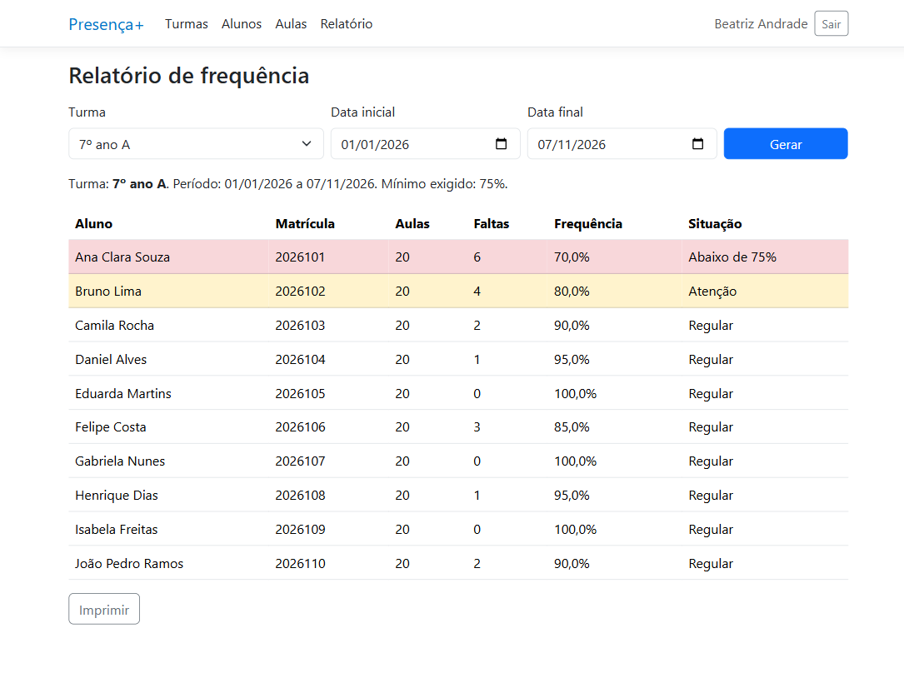

Figura X — CT01: login com dados válidos

Fonte: elaborado pelo autor (2026).

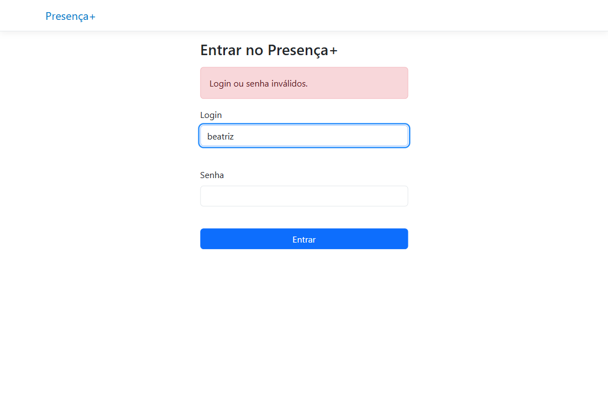

Figura X — CT02: login com senha errada

Fonte: elaborado pelo autor (2026).

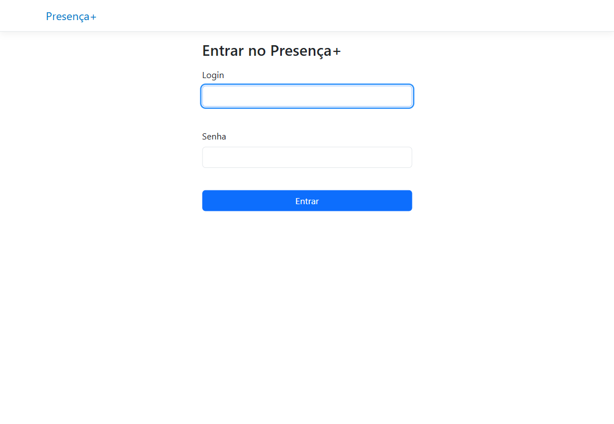

Figura X — CT03: acesso a `/Alunos` sem login

Fonte: elaborado pelo autor (2026).

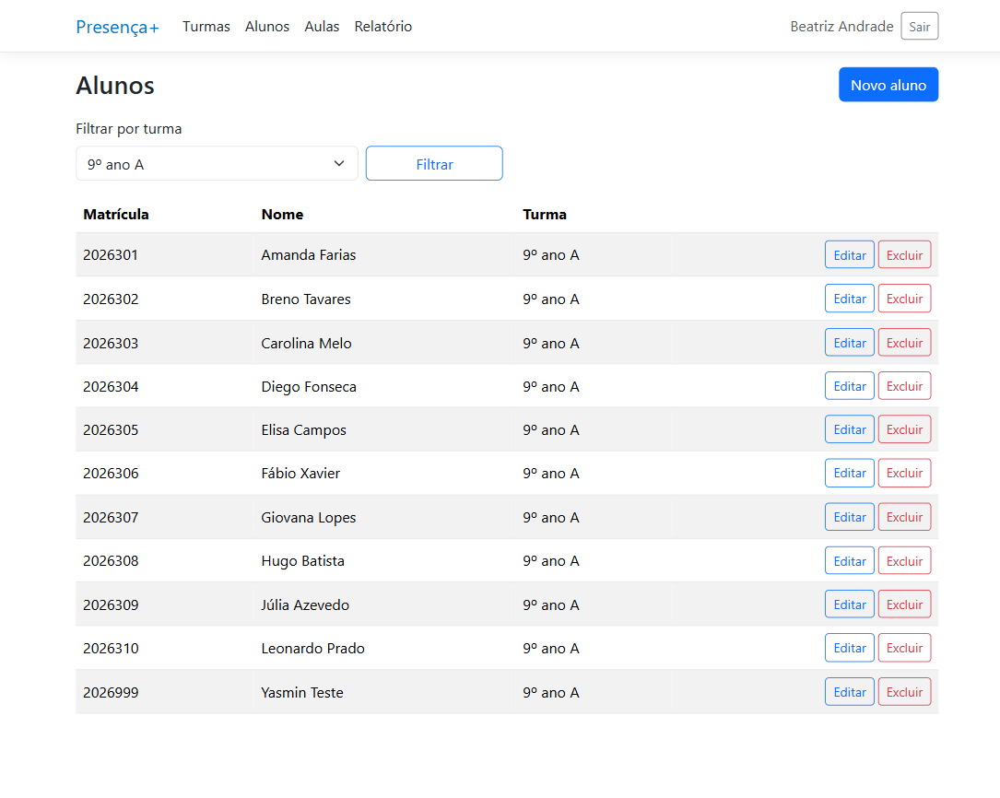

Figura X — CT04: aluno cadastrado e exibido na lista

Fonte: elaborado pelo autor (2026).

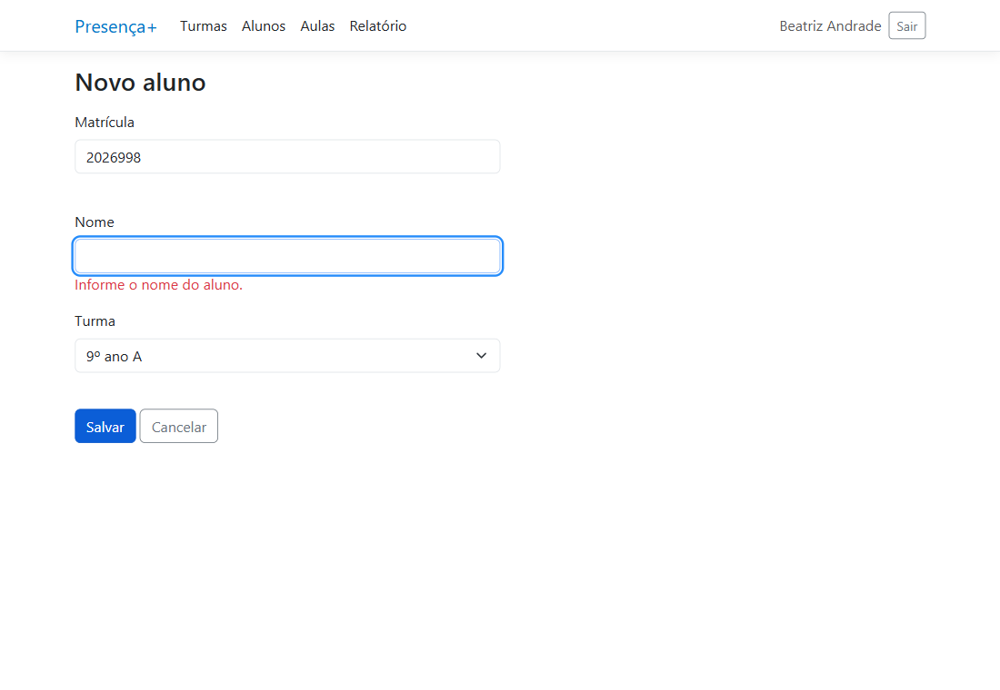

Figura X — CT05: cadastro de aluno sem nome

Fonte: elaborado pelo autor (2026).

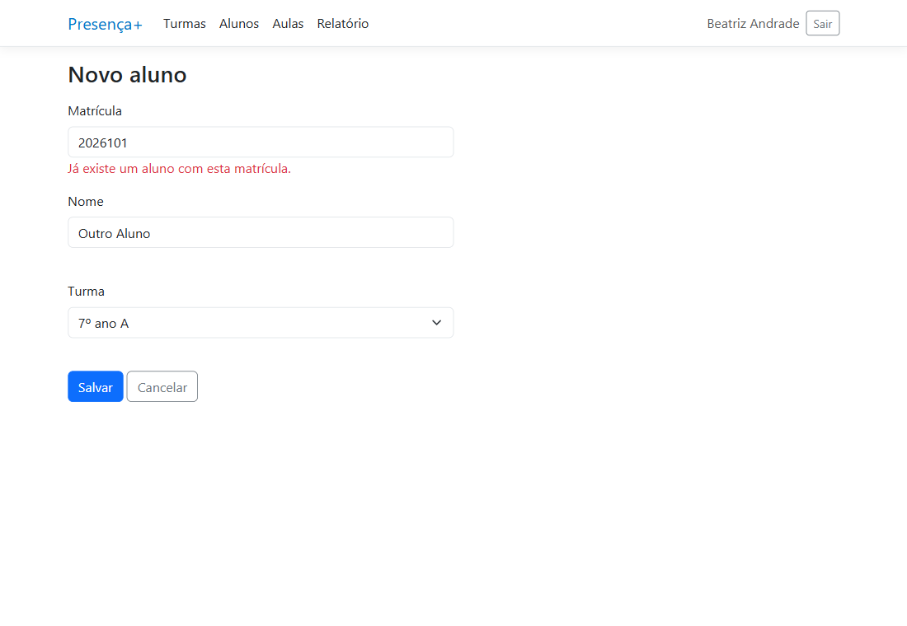

Figura X — CT06: matrícula repetida

Fonte: elaborado pelo autor (2026).

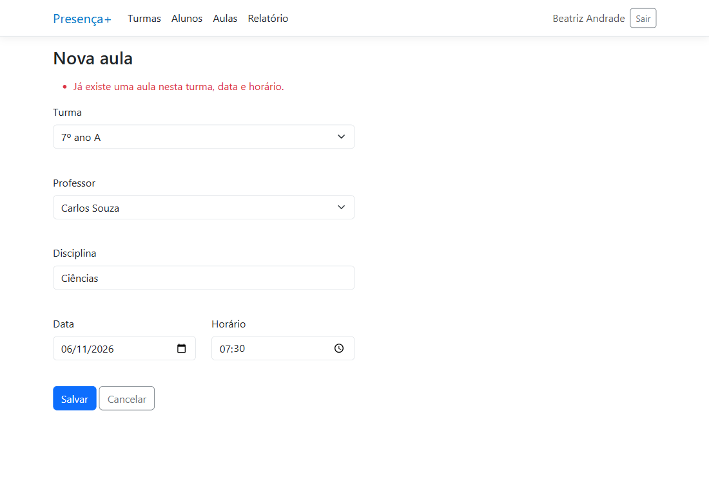

Figura X — CT07: aula em turma, data e horário já ocupados

Fonte: elaborado pelo autor (2026).

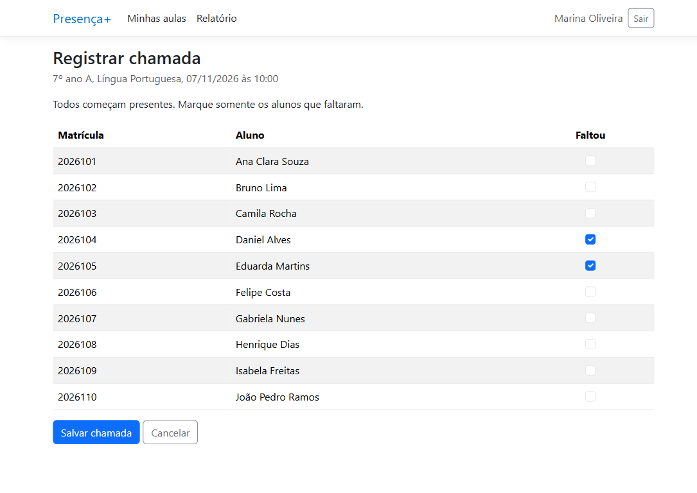

Figura X — CT08: chamada reaberta com as duas faltas marcadas

Fonte: elaborado pelo autor (2026).

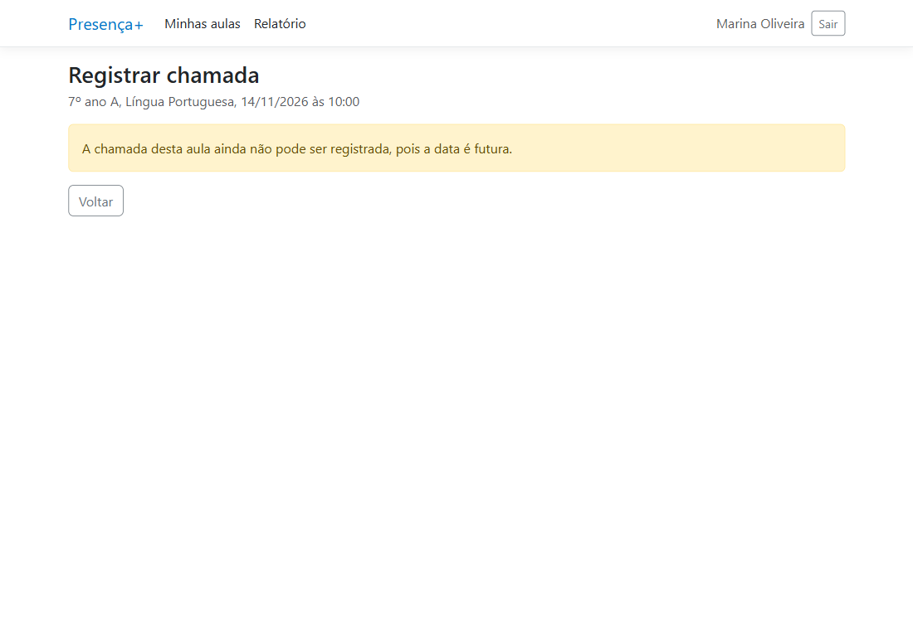

Figura X — CT09: tentativa de chamada em aula futura

Fonte: elaborado pelo autor (2026).

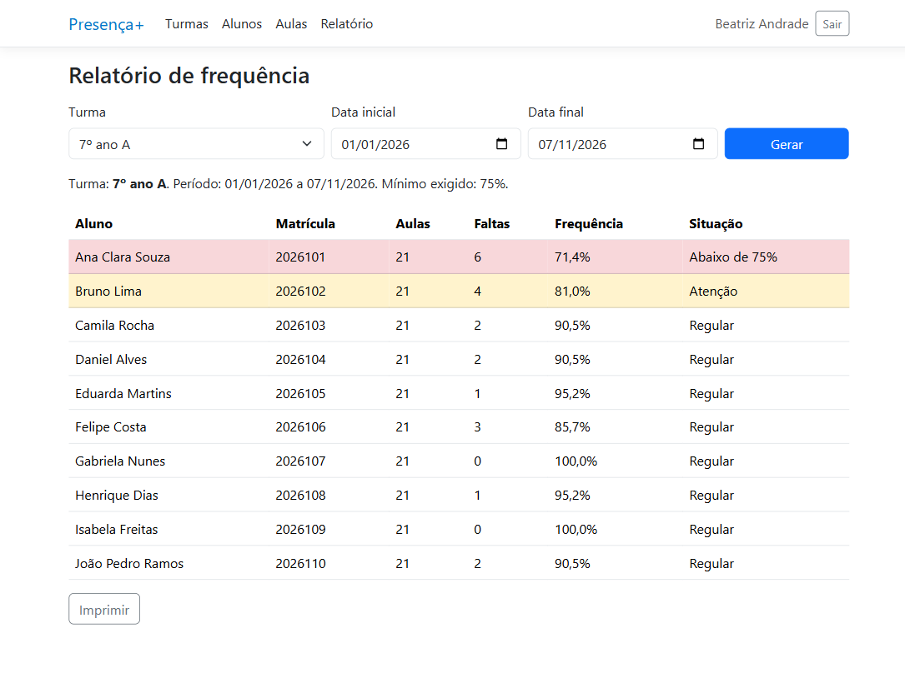

Figura X — CT10: relatório usado na conferência do cálculo

Fonte: elaborado pelo autor (2026).

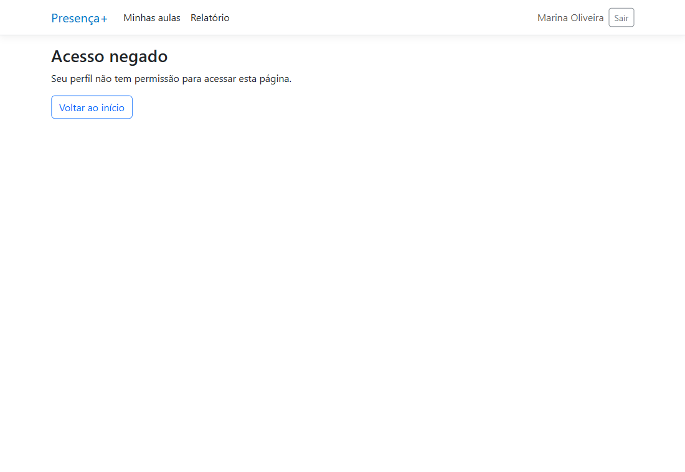

Figura X — CT11: professor em página da Coordenação

Fonte: elaborado pelo autor (2026).
